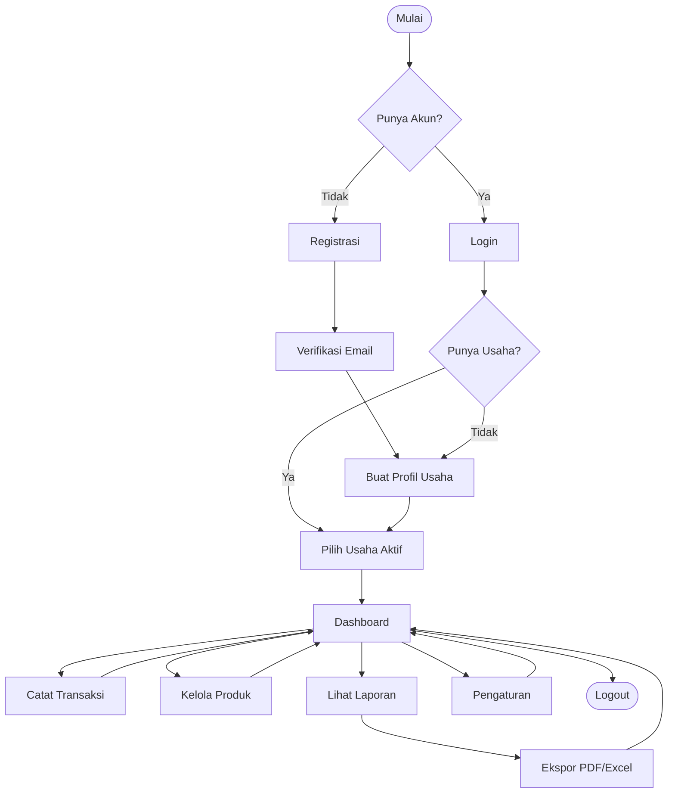
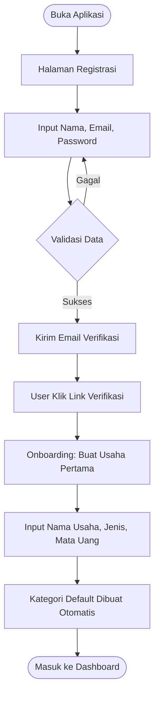
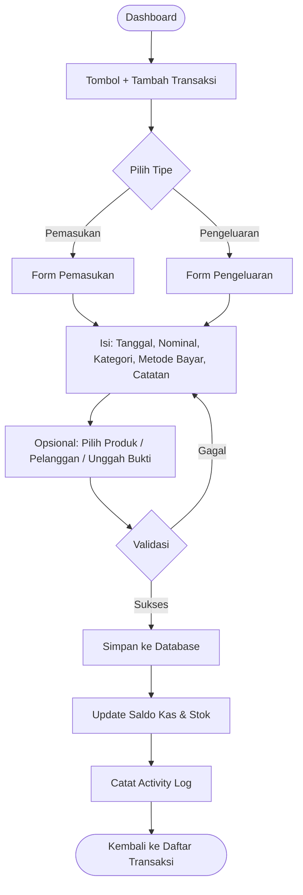
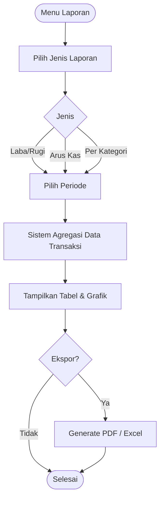
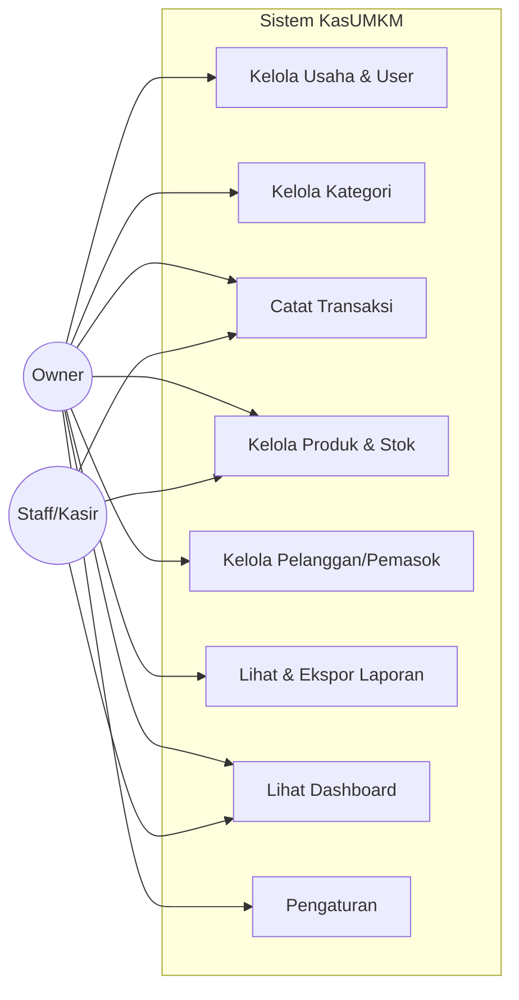
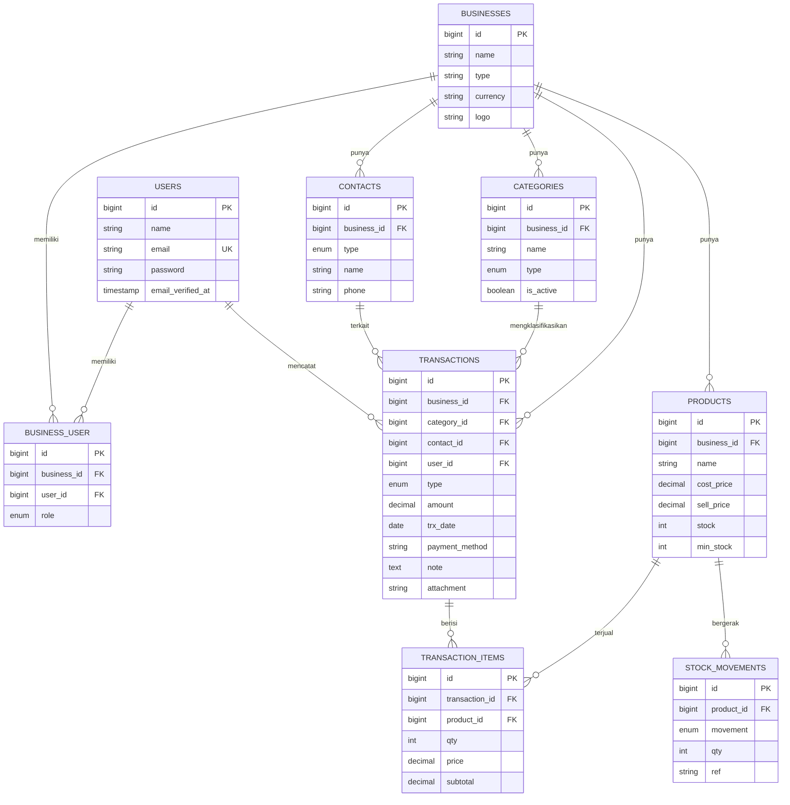
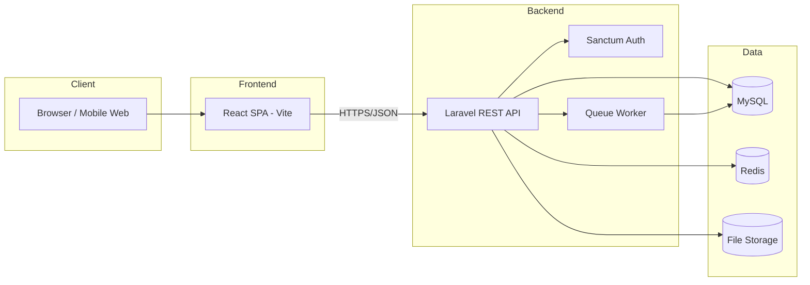
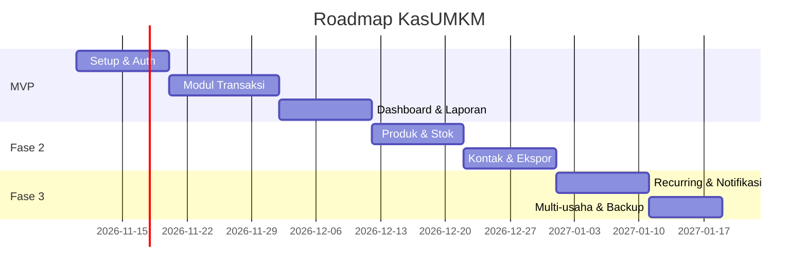

# BUSINESS REQUIREMENTS SPECIFICATION (BRS)
# Aplikasi Keuangan UMKM — "KasUMKM"

---

| Informasi Dokumen | Detail |
|---|---|
| **Nama Proyek** | KasUMKM — Aplikasi Keuangan Sederhana untuk UMKM |
| **Versi Dokumen** | 1.0 |
| **Tanggal** | 03 November 2026 |
| **Status** | Draft / For Review |
| **Jenis Dokumen** | Business Requirements Specification (BRS) |
| **Teknologi** | Laravel (latest) + React + MySQL |
| **Penyusun** | Tim Pengembang |
| **Pemilik Dokumen** | Product Owner |

### Riwayat Revisi

| Versi | Tanggal | Deskripsi Perubahan | Penulis |
|---|---|---|---|
| 0.1 | 01-11-2026 | Draft awal kerangka dokumen | Tim Dev |
| 1.0 | 03-11-2026 | Dokumen lengkap pertama | Tim Dev |

### Persetujuan (Sign-off)

| Peran | Nama | Tanda Tangan | Tanggal |
|---|---|---|---|
| Product Owner | | | |
| Business Analyst | | | |
| Technical Lead | | | |
| QA Lead | | | |

---

## DAFTAR ISI

1. [Pendahuluan](#1-pendahuluan)
2. [Gambaran Umum Bisnis](#2-gambaran-umum-bisnis)
3. [Ruang Lingkup (Scope)](#3-ruang-lingkup-scope)
4. [Stakeholder & Peran Pengguna](#4-stakeholder--peran-pengguna)
5. [Daftar Fitur & Kebutuhan Fungsional](#5-daftar-fitur--kebutuhan-fungsional)
6. [Kebutuhan Non-Fungsional](#6-kebutuhan-non-fungsional)
7. [Application Flow (Alur Aplikasi)](#7-application-flow-alur-aplikasi)
8. [Wireframe / Mockup Antarmuka](#8-wireframe--mockup-antarmuka)
9. [Perancangan Data (ERD & Kamus Data)](#9-perancangan-data-erd--kamus-data)
10. [Arsitektur & Teknologi](#10-arsitektur--teknologi)
11. [Perancangan API (REST)](#11-perancangan-api-rest)
12. [Keamanan, Hak Akses & Hardening](#12-keamanan-hak-akses--hardening)
13. [Rencana Rilis (Roadmap)](#13-rencana-rilis-roadmap)
14. [Asumsi, Batasan & Risiko](#14-asumsi-batasan--risiko)
15. [Lampiran & Glosarium](#15-lampiran--glosarium)

---

## 1. PENDAHULUAN

### 1.1 Tujuan Dokumen
Dokumen ini menjelaskan kebutuhan bisnis dan fungsional untuk pengembangan **KasUMKM**, sebuah aplikasi pencatatan keuangan sederhana yang ditujukan bagi pelaku Usaha Mikro, Kecil, dan Menengah (UMKM). Dokumen ini menjadi acuan bersama antara tim bisnis, pengembang, dan QA selama siklus pengembangan.

### 1.2 Latar Belakang
Mayoritas pelaku UMKM belum memiliki pembukuan yang rapi. Pencatatan keuangan masih dilakukan secara manual (buku tulis/kertas) atau tercampur antara uang pribadi dan uang usaha. Akibatnya pemilik usaha sulit:
- Mengetahui untung/rugi yang sebenarnya.
- Memantau arus kas (cash flow).
- Menyiapkan laporan untuk pengajuan modal/pinjaman.

**KasUMKM** hadir sebagai solusi sederhana, murah, dan mudah dipakai tanpa latar belakang akuntansi.

### 1.3 Target Pengguna
- Pemilik warung, toko kelontong, kedai makanan.
- Usaha jasa kecil (laundry, bengkel, salon).
- Reseller / online shop skala kecil–menengah.

### 1.4 Definisi Singkat
Lihat [Glosarium](#15-lampiran--glosarium) pada bagian lampiran.

---

## 2. GAMBARAN UMUM BISNIS

### 2.1 Tujuan Bisnis (Business Goals)
| Kode | Tujuan |
|---|---|
| BG-01 | Membantu UMKM mencatat pemasukan & pengeluaran dengan mudah. |
| BG-02 | Menyediakan laporan laba/rugi dan arus kas otomatis. |
| BG-03 | Memisahkan keuangan usaha dari keuangan pribadi. |
| BG-04 | Membantu pemantauan stok/produk sederhana. |
| BG-05 | Menyediakan data yang bisa diekspor untuk keperluan pajak/pinjaman. |

### 2.2 Indikator Keberhasilan (Success Metrics)
| Kode | Metrik | Target |
|---|---|---|
| SM-01 | Waktu mencatat 1 transaksi | < 15 detik |
| SM-02 | Retensi pengguna aktif bulanan | > 40% |
| SM-03 | Akurasi laporan laba/rugi | 100% sesuai input |
| SM-04 | Uptime sistem | > 99% |

### 2.3 Proses Bisnis Saat Ini vs Usulan
**Saat ini (As-Is):** Catatan manual → rentan hilang → sulit direkap → tidak ada laporan.
**Usulan (To-Be):** Input digital → tersimpan aman → rekap & laporan otomatis → bisa diekspor.

---

## 3. RUANG LINGKUP (SCOPE)

### 3.1 Termasuk dalam Lingkup (In-Scope)
- Manajemen akun & profil usaha (multi-usaha per pengguna).
- Pencatatan transaksi pemasukan & pengeluaran.
- Kategori transaksi.
- Manajemen produk/jasa & stok sederhana.
- Manajemen pelanggan & pemasok (opsional per transaksi).
- Laporan keuangan (laba/rugi, arus kas, ringkasan harian/bulanan).
- Dashboard ringkasan.
- Ekspor laporan ke PDF/Excel.
- Multi-user per usaha dengan peran (Owner, Staff).

### 3.2 Di Luar Lingkup (Out-of-Scope) — Fase 1
- Integrasi payment gateway / pembayaran online.
- Akuntansi double-entry penuh (neraca, jurnal umum lengkap).
- Perhitungan & pelaporan pajak otomatis ke DJP.
- Integrasi marketplace (Shopee/Tokopedia).
- Aplikasi mobile native (fase 1 fokus web responsif).

---

## 4. STAKEHOLDER & PERAN PENGGUNA

### 4.1 Stakeholder
| Stakeholder | Kepentingan |
|---|---|
| Pemilik UMKM | Pengguna utama, butuh kemudahan & laporan. |
| Karyawan/Kasir | Input transaksi harian. |
| Tim Pengembang | Membangun & memelihara sistem. |
| Investor/Bank (eksternal) | Konsumen laporan (via ekspor). |

### 4.2 Peran Pengguna (Roles)
| Role | Deskripsi | Hak Akses Utama |
|---|---|---|
| **Owner** | Pemilik usaha | Akses penuh: kelola usaha, user, transaksi, laporan, pengaturan. |
| **Staff/Kasir** | Karyawan | Input & lihat transaksi, lihat produk; tidak bisa kelola user atau hapus data sensitif. |
| **Super Admin** (internal) | Pengelola platform | Kelola akun, monitoring sistem (backend only). |


---

## 5. DAFTAR FITUR & KEBUTUHAN FUNGSIONAL

Penomoran kebutuhan fungsional menggunakan format **FR-XX**. Prioritas menggunakan metode **MoSCoW** (M=Must, S=Should, C=Could, W=Won't/Nanti).

### 5.1 Modul Autentikasi & Akun
| Kode | Kebutuhan Fungsional | Prioritas |
|---|---|---|
| FR-01 | Pengguna dapat registrasi akun menggunakan email & password. | M |
| FR-02 | Pengguna dapat login & logout. | M |
| FR-03 | Pengguna dapat melakukan reset password via email. | S |
| FR-04 | Sistem memverifikasi email saat registrasi. | S |
| FR-05 | Pengguna dapat mengubah profil & ganti password. | M |

### 5.2 Modul Manajemen Usaha (Business/Tenant)
| Kode | Kebutuhan Fungsional | Prioritas |
|---|---|---|
| FR-06 | Owner dapat membuat profil usaha (nama, jenis, logo, mata uang). | M |
| FR-07 | Owner dapat memiliki lebih dari satu usaha dan berpindah usaha aktif. | S |
| FR-08 | Owner dapat mengundang Staff ke sebuah usaha. | S |
| FR-09 | Owner dapat mengatur peran & menghapus anggota usaha. | S |

### 5.3 Modul Kategori
| Kode | Kebutuhan Fungsional | Prioritas |
|---|---|---|
| FR-10 | Pengguna dapat membuat kategori pemasukan & pengeluaran. | M |
| FR-11 | Sistem menyediakan kategori default (Penjualan, Modal, Gaji, Sewa, dll). | S |
| FR-12 | Pengguna dapat edit & nonaktifkan kategori. | M |

### 5.4 Modul Transaksi (Inti)
| Kode | Kebutuhan Fungsional | Prioritas |
|---|---|---|
| FR-13 | Pengguna dapat mencatat transaksi pemasukan (income). | M |
| FR-14 | Pengguna dapat mencatat transaksi pengeluaran (expense). | M |
| FR-15 | Transaksi mencakup: tanggal, nominal, kategori, metode bayar, catatan, lampiran bukti. | M |
| FR-16 | Pengguna dapat mengaitkan transaksi dengan pelanggan/pemasok (opsional). | C |
| FR-17 | Pengguna dapat mengunggah foto bukti/struk. | S |
| FR-18 | Pengguna dapat mengedit & menghapus transaksi (sesuai hak akses). | M |
| FR-19 | Pengguna dapat memfilter & mencari transaksi (tanggal, kategori, tipe). | M |
| FR-20 | Sistem mendukung transaksi berulang (recurring) seperti sewa bulanan. | C |

### 5.5 Modul Produk & Stok Sederhana
| Kode | Kebutuhan Fungsional | Prioritas |
|---|---|---|
| FR-21 | Pengguna dapat menambah produk/jasa (nama, harga jual, harga modal, stok). | S |
| FR-22 | Saat transaksi penjualan, stok produk berkurang otomatis. | C |
| FR-23 | Sistem memberi notifikasi stok menipis. | C |
| FR-24 | Pengguna dapat melihat riwayat pergerakan stok. | C |

### 5.6 Modul Pelanggan & Pemasok
| Kode | Kebutuhan Fungsional | Prioritas |
|---|---|---|
| FR-25 | Pengguna dapat mengelola data pelanggan (nama, kontak). | C |
| FR-26 | Pengguna dapat mengelola data pemasok. | C |
| FR-27 | Pengguna dapat melihat total transaksi per pelanggan/pemasok. | C |

### 5.7 Modul Laporan
| Kode | Kebutuhan Fungsional | Prioritas |
|---|---|---|
| FR-28 | Laporan Laba/Rugi (total pemasukan − pengeluaran per periode). | M |
| FR-29 | Laporan Arus Kas (cash flow masuk/keluar per periode). | M |
| FR-30 | Ringkasan harian, mingguan, bulanan. | M |
| FR-31 | Laporan per kategori (pie/bar chart). | S |
| FR-32 | Ekspor laporan ke PDF & Excel. | S |
| FR-33 | Filter laporan berdasarkan rentang tanggal kustom. | M |

### 5.8 Modul Dashboard
| Kode | Kebutuhan Fungsional | Prioritas |
|---|---|---|
| FR-34 | Dashboard menampilkan saldo kas terkini. | M |
| FR-35 | Dashboard menampilkan total pemasukan & pengeluaran bulan berjalan. | M |
| FR-36 | Dashboard menampilkan grafik tren 6–12 bulan. | S |
| FR-37 | Dashboard menampilkan transaksi terbaru. | M |

### 5.9 Modul Pengaturan
| Kode | Kebutuhan Fungsional | Prioritas |
|---|---|---|
| FR-38 | Pengaturan mata uang & format tanggal. | S |
| FR-39 | Pengaturan metode pembayaran (Tunai, Transfer, QRIS, E-wallet). | S |
| FR-40 | Backup/ekspor seluruh data usaha. | C |

---

## 6. KEBUTUHAN NON-FUNGSIONAL

Penomoran menggunakan format **NFR-XX**.

| Kode | Kategori | Kebutuhan |
|---|---|---|
| NFR-01 | **Usability** | Antarmuka sederhana, bahasa Indonesia, dapat dipakai tanpa latar belakang akuntansi. Input transaksi < 15 detik. |
| NFR-02 | **Responsiveness** | Web responsif, optimal di mobile & desktop (mobile-first). |
| NFR-03 | **Performance** | Waktu muat halaman < 2 detik pada koneksi 4G; respons API < 500 ms (p95). |
| NFR-04 | **Security** | Mengikuti standar keamanan & hardening pada Bab 12 (OWASP Top 10, ASVS, CIS): password di-hash, HTTPS, proteksi CSRF/XSS/SQLi, rate limiting, otorisasi berbasis peran, isolasi multi-tenant. |
| NFR-05 | **Scalability** | Arsitektur mendukung multi-tenant (banyak usaha) dengan isolasi data. |
| NFR-06 | **Availability** | Uptime target > 99%. |
| NFR-07 | **Reliability** | Backup database harian otomatis. |
| NFR-08 | **Maintainability** | Kode mengikuti standar PSR-12 (PHP) & ESLint/Prettier (React). |
| NFR-09 | **Compatibility** | Mendukung browser modern (Chrome, Firefox, Edge, Safari 2 versi terakhir). |
| NFR-10 | **Localization** | Format mata uang Rupiah (Rp) dan tanggal lokal Indonesia secara default. |
| NFR-11 | **Auditability** | Pencatatan log aktivitas (siapa membuat/mengubah/menghapus transaksi). |
| NFR-12 | **Data Integrity** | Validasi input ketat, transaksi database atomik. |

---

## 7. APPLICATION FLOW (ALUR APLIKASI)

Bagian ini menjelaskan alur utama aplikasi. Diagram menggunakan sintaks **Mermaid** sehingga dapat dirender langsung di GitHub/VS Code (ekstensi Markdown Preview Mermaid).

### 7.1 Diagram Alur Tingkat Tinggi (High-Level Flow)



### 7.2 Alur Registrasi & Onboarding



### 7.3 Alur Pencatatan Transaksi (Inti)



### 7.4 Alur Pembuatan Laporan



### 7.5 Use Case Diagram (Ringkas)



### 7.6 Deskripsi Use Case Utama (Contoh: Catat Transaksi Pemasukan)

| Elemen | Deskripsi |
|---|---|
| **ID Use Case** | UC-03 |
| **Nama** | Catat Transaksi Pemasukan |
| **Aktor** | Owner, Staff |
| **Prakondisi** | Pengguna sudah login & memilih usaha aktif. |
| **Alur Utama** | 1. Pengguna menekan "Tambah Transaksi". 2. Memilih tipe "Pemasukan". 3. Mengisi form. 4. Menyimpan. 5. Sistem menyimpan & memperbarui saldo. |
| **Alur Alternatif** | 3a. Validasi gagal → tampilkan pesan error, kembali ke form. |
| **Pascakondisi** | Transaksi tersimpan, saldo kas bertambah, activity log tercatat. |


---

## 8. WIREFRAME / MOCKUP ANTARMUKA

Wireframe disajikan dalam bentuk *low-fidelity* (ASCII) agar jelas menggambarkan tata letak. Desain final mengikuti pendekatan **mobile-first** & **clean UI**.

### 8.1 Halaman Login

```
+-------------------------------------------+
|                 KasUMKM                   |
|          Catat Keuangan Usahamu           |
|                                           |
|   +-----------------------------------+   |
|   |  Email                            |   |
|   +-----------------------------------+   |
|   +-----------------------------------+   |
|   |  Password                      [o]|   |
|   +-----------------------------------+   |
|                        Lupa Password?     |
|   +-----------------------------------+   |
|   |            [  MASUK  ]            |   |
|   +-----------------------------------+   |
|                                           |
|   Belum punya akun?  Daftar di sini       |
+-------------------------------------------+
```

### 8.2 Dashboard (Desktop)

```
+----------------------------------------------------------------------+
| KasUMKM   [Usaha: Warung Bu Siti v]        (bell)  Bu Siti (Owner) v |
+-----------+----------------------------------------------------------+
| MENU      |  DASHBOARD                       Periode: November 2026  |
|           |                                                          |
| Dashboard |  +----------------+ +----------------+ +--------------+  |
| Transaksi |  | SALDO KAS      | | PEMASUKAN      | | PENGELUARAN  |  |
| Produk    |  | Rp 12.500.000  | | Rp 8.000.000   | | Rp 3.200.000 |  |
| Pelanggan |  +----------------+ +----------------+ +--------------+  |
| Laporan   |                                                         |
| Pengaturan|  +--------------------------------------------------+   |
|           |  |  Grafik Arus Kas (6 Bulan Terakhir)              |   |
|           |  |     ^                                            |   |
|           |  |     |     __        __                           |   |
|           |  |     |  __/  \__  __/  \__                        |   |
|           |  |     +----------------------------->              |   |
|           |  +--------------------------------------------------+   |
|           |                                                         |
|           |  TRANSAKSI TERBARU                     [+ Tambah]       |
|           |  +--------------------------------------------------+   |
|           |  | 03 Nov | Penjualan  | Masuk  | +Rp 250.000       |   |
|           |  | 03 Nov | Beli Stok  | Keluar | -Rp 500.000       |   |
|           |  | 02 Nov | Penjualan  | Masuk  | +Rp 180.000       |   |
|           |  +--------------------------------------------------+   |
+-----------+----------------------------------------------------------+
```

### 8.3 Dashboard (Mobile)

```
+---------------------------+
|  =  KasUMKM      (bell)(o)|
+---------------------------+
| Warung Bu Siti        [v] |
|                           |
| +-----------------------+ |
| |  SALDO KAS            | |
| |  Rp 12.500.000        | |
| +-----------------------+ |
| +---------+ +-----------+ |
| | Masuk   | | Keluar    | |
| | 8.0 Jt  | | 3.2 Jt    | |
| +---------+ +-----------+ |
|                           |
| Transaksi Terbaru         |
| - Penjualan   +250.000    |
| - Beli Stok   -500.000    |
| - Penjualan   +180.000    |
|                           |
+---------------------------+
| [Home] [Lap] [ + ] [Prd][*]|
+---------------------------+
```


### 8.4 Form Tambah Transaksi

```
+-------------------------------------------+
|  <-  Tambah Transaksi                     |
+-------------------------------------------+
|  Tipe:  ( * Pemasukan )  ( o Pengeluaran )|
|                                           |
|  Nominal                                  |
|  +-------------------------------------+  |
|  | Rp  250.000                         |  |
|  +-------------------------------------+  |
|                                           |
|  Tanggal              Kategori            |
|  +----------------+   +----------------+  |
|  | 03/11/2026     |   | Penjualan    v |  |
|  +----------------+   +----------------+  |
|                                           |
|  Metode Bayar                             |
|  +-------------------------------------+  |
|  | Tunai                            v  |  |
|  +-------------------------------------+  |
|                                           |
|  Produk (opsional)                        |
|  +-------------------------------------+  |
|  | Pilih produk...                  v  |  |
|  +-------------------------------------+  |
|                                           |
|  Catatan                                  |
|  +-------------------------------------+  |
|  |                                     |  |
|  +-------------------------------------+  |
|                                           |
|  [ Unggah Bukti ]                         |
|                                           |
|  +-----------------+  +-----------------+ |
|  |    Batal        |  |    SIMPAN       | |
|  +-----------------+  +-----------------+ |
+-------------------------------------------+
```

### 8.5 Daftar Transaksi

```
+----------------------------------------------------------------------+
|  Transaksi                                          [+ Tambah]        |
+----------------------------------------------------------------------+
|  [Cari...]   [Tipe: Semua v] [Kategori: Semua v] [Periode v]         |
+----------------------------------------------------------------------+
|  Tanggal    | Kategori    | Catatan        | Tipe   |      Nominal    |
|-------------|-------------|----------------|--------|-----------------|
|  03/11/2026 | Penjualan   | Order online   | Masuk  |   +Rp 250.000   |
|  03/11/2026 | Pembelian   | Stok gula      | Keluar |   -Rp 500.000   |
|  02/11/2026 | Penjualan   | Kasir pagi     | Masuk  |   +Rp 180.000   |
|  01/11/2026 | Sewa        | Sewa kios Nov  | Keluar | -Rp 1.000.000   |
+----------------------------------------------------------------------+
|                                   << 1 2 3 ... >>                     |
+----------------------------------------------------------------------+
```

### 8.6 Halaman Laporan

```
+----------------------------------------------------------------------+
|  Laporan Laba / Rugi            Periode: [01 Nov - 30 Nov 2026]       |
|                                           [v PDF] [v Excel]          |
+----------------------------------------------------------------------+
|  +-------------------------+   +--------------------------------+    |
|  |  RINGKASAN              |   |   Komposisi Pengeluaran        |    |
|  |  Pemasukan : 8.000.000  |   |        ____                    |    |
|  |  Pengeluaran: 3.200.000 |   |      /      \   Stok 50%        |    |
|  |  ---------------------  |   |     |  PIE   |  Sewa 30%        |    |
|  |  LABA : Rp 4.800.000    |   |      \ ____ /   Gaji 20%        |    |
|  +-------------------------+   +--------------------------------+    |
|                                                                      |
|  Rincian per Kategori                                                |
|  +----------------------------------------------------------------+  |
|  | Kategori      | Pemasukan     | Pengeluaran                    |  |
|  |---------------|---------------|--------------------------------|  |
|  | Penjualan     | 8.000.000     | -                              |  |
|  | Pembelian Stok| -             | 1.600.000                      |  |
|  | Sewa          | -             | 1.000.000                      |  |
|  | Gaji          | -             | 600.000                        |  |
|  +----------------------------------------------------------------+  |
+----------------------------------------------------------------------+
```

### 8.7 Catatan Desain UI
- **Warna utama:** hijau (keuangan sehat) + aksen biru. Pemasukan = hijau, Pengeluaran = merah.
- **Tombol aksi utama (FAB "+")** selalu mudah dijangkau di mobile.
- **Angka besar & jelas** untuk saldo — target pengguna awam.
- Gunakan komponen UI konsisten (disarankan **Tailwind CSS + shadcn/ui** atau **Material UI**).


---

## 9. PERANCANGAN DATA (ERD & KAMUS DATA)

### 9.1 Entity Relationship Diagram (ERD)




### 9.2 Kamus Data (Data Dictionary)

#### Tabel: `users`
| Kolom | Tipe | Null | Keterangan |
|---|---|---|---|
| id | BIGINT UNSIGNED PK AI | No | ID pengguna |
| name | VARCHAR(100) | No | Nama lengkap |
| email | VARCHAR(150) UNIQUE | No | Email login |
| password | VARCHAR(255) | No | Hash password |
| email_verified_at | TIMESTAMP | Yes | Waktu verifikasi email |
| remember_token | VARCHAR(100) | Yes | Token "remember me" |
| created_at / updated_at | TIMESTAMP | Yes | Audit waktu |

#### Tabel: `businesses`
| Kolom | Tipe | Null | Keterangan |
|---|---|---|---|
| id | BIGINT PK AI | No | ID usaha |
| name | VARCHAR(120) | No | Nama usaha |
| type | VARCHAR(50) | Yes | Jenis usaha (kuliner, retail, jasa) |
| currency | VARCHAR(5) | No | Default 'IDR' |
| logo | VARCHAR(255) | Yes | Path logo |
| created_at / updated_at | TIMESTAMP | Yes | Audit |

#### Tabel: `business_user` (pivot)
| Kolom | Tipe | Null | Keterangan |
|---|---|---|---|
| id | BIGINT PK AI | No | ID |
| business_id | BIGINT FK | No | Relasi ke businesses |
| user_id | BIGINT FK | No | Relasi ke users |
| role | ENUM('owner','staff') | No | Peran dalam usaha |

#### Tabel: `categories`
| Kolom | Tipe | Null | Keterangan |
|---|---|---|---|
| id | BIGINT PK AI | No | ID kategori |
| business_id | BIGINT FK | No | Relasi usaha |
| name | VARCHAR(80) | No | Nama kategori |
| type | ENUM('income','expense') | No | Tipe kategori |
| is_active | BOOLEAN | No | Default true |

#### Tabel: `transactions`
| Kolom | Tipe | Null | Keterangan |
|---|---|---|---|
| id | BIGINT PK AI | No | ID transaksi |
| business_id | BIGINT FK | No | Relasi usaha |
| category_id | BIGINT FK | Yes | Relasi kategori |
| contact_id | BIGINT FK | Yes | Pelanggan/pemasok |
| user_id | BIGINT FK | No | Pencatat transaksi |
| type | ENUM('income','expense') | No | Tipe transaksi |
| amount | DECIMAL(15,2) | No | Nominal |
| trx_date | DATE | No | Tanggal transaksi |
| payment_method | VARCHAR(30) | Yes | Tunai/Transfer/QRIS/E-wallet |
| note | TEXT | Yes | Catatan |
| attachment | VARCHAR(255) | Yes | Path bukti |
| created_at / updated_at | TIMESTAMP | Yes | Audit |

#### Tabel: `transaction_items`
| Kolom | Tipe | Null | Keterangan |
|---|---|---|---|
| id | BIGINT PK AI | No | ID |
| transaction_id | BIGINT FK | No | Relasi transaksi |
| product_id | BIGINT FK | No | Relasi produk |
| qty | INT | No | Jumlah |
| price | DECIMAL(15,2) | No | Harga satuan |
| subtotal | DECIMAL(15,2) | No | qty x price |

#### Tabel: `products`
| Kolom | Tipe | Null | Keterangan |
|---|---|---|---|
| id | BIGINT PK AI | No | ID produk |
| business_id | BIGINT FK | No | Relasi usaha |
| name | VARCHAR(120) | No | Nama produk/jasa |
| cost_price | DECIMAL(15,2) | Yes | Harga modal |
| sell_price | DECIMAL(15,2) | No | Harga jual |
| stock | INT | No | Stok saat ini (default 0) |
| min_stock | INT | Yes | Ambang notifikasi |

#### Tabel: `contacts`
| Kolom | Tipe | Null | Keterangan |
|---|---|---|---|
| id | BIGINT PK AI | No | ID kontak |
| business_id | BIGINT FK | No | Relasi usaha |
| type | ENUM('customer','supplier') | No | Jenis kontak |
| name | VARCHAR(120) | No | Nama |
| phone | VARCHAR(20) | Yes | Nomor telepon |

#### Tabel: `stock_movements`
| Kolom | Tipe | Null | Keterangan |
|---|---|---|---|
| id | BIGINT PK AI | No | ID |
| product_id | BIGINT FK | No | Relasi produk |
| movement | ENUM('in','out','adjust') | No | Jenis pergerakan |
| qty | INT | No | Jumlah |
| ref | VARCHAR(100) | Yes | Referensi (mis. ID transaksi) |

#### Tabel: `activity_logs`
| Kolom | Tipe | Null | Keterangan |
|---|---|---|---|
| id | BIGINT PK AI | No | ID |
| business_id | BIGINT FK | No | Relasi usaha |
| user_id | BIGINT FK | No | Pelaku |
| action | VARCHAR(50) | No | create/update/delete |
| entity | VARCHAR(50) | No | Nama entitas |
| entity_id | BIGINT | Yes | ID entitas |
| description | TEXT | Yes | Deskripsi |
| created_at | TIMESTAMP | No | Waktu |


---

## 10. ARSITEKTUR & TEKNOLOGI

### 10.1 Stack Teknologi
| Layer | Teknologi | Keterangan |
|---|---|---|
| **Frontend** | React 18+ (Vite), React Router, TanStack Query, Axios | SPA responsif |
| **UI** | Tailwind CSS + shadcn/ui, Recharts (grafik) | Komponen & visualisasi |
| **Backend** | Laravel (latest, PHP 8.3+) | REST API |
| **Autentikasi** | Laravel Sanctum | Token-based SPA auth |
| **Database** | MySQL 8.x | Penyimpanan utama |
| **Cache/Queue** | Redis (opsional) | Cache & antrian job |
| **Export** | Laravel Excel (maatwebsite), DomPDF | Ekspor Excel & PDF |
| **Storage** | Local / S3-compatible | Simpan bukti/struk |
| **Web Server** | Nginx + PHP-FPM | Production |

### 10.2 Diagram Arsitektur



### 10.3 Pola Arsitektur Aplikasi
- **Backend:** mengikuti pola **Service + Repository** di atas Eloquent, dengan **Form Request** untuk validasi, **API Resource** untuk serialisasi, dan **Policy** untuk otorisasi.
- **Multi-tenant:** isolasi data per `business_id` menggunakan **Global Scope** Eloquent yang membaca usaha aktif dari konteks pengguna.
- **Frontend:** struktur berbasis fitur (feature-based folder), state server dikelola **TanStack Query**, state UI lokal via hooks.

### 10.4 Struktur Folder (Ringkas)
```
/backend (Laravel)
  app/
    Models/        -> Eloquent models
    Http/
      Controllers/Api/
      Requests/     -> validasi
      Resources/    -> API resources
    Services/       -> logika bisnis
    Policies/
  database/migrations/
  routes/api.php

/frontend (React)
  src/
    features/
      auth/
      dashboard/
      transactions/
      products/
      reports/
    components/     -> UI reusable
    lib/            -> axios, query client
    hooks/
    App.jsx
```

---

## 11. PERANCANGAN API (REST)

Base URL: `/api/v1`. Semua endpoint (kecuali auth) memerlukan header `Authorization: Bearer <token>` dan header `X-Business-Id` untuk konteks usaha aktif.

### 11.1 Autentikasi
| Method | Endpoint | Deskripsi |
|---|---|---|
| POST | `/auth/register` | Registrasi pengguna |
| POST | `/auth/login` | Login, kembalikan token |
| POST | `/auth/logout` | Logout (hapus token) |
| POST | `/auth/forgot-password` | Kirim link reset |
| POST | `/auth/reset-password` | Reset password |
| GET | `/auth/me` | Profil pengguna aktif |

### 11.2 Usaha (Business)
| Method | Endpoint | Deskripsi |
|---|---|---|
| GET | `/businesses` | Daftar usaha milik pengguna |
| POST | `/businesses` | Buat usaha |
| PUT | `/businesses/{id}` | Ubah usaha |
| POST | `/businesses/{id}/members` | Undang anggota |
| DELETE | `/businesses/{id}/members/{userId}` | Hapus anggota |

### 11.3 Kategori
| Method | Endpoint | Deskripsi |
|---|---|---|
| GET | `/categories` | Daftar kategori (filter `?type=`) |
| POST | `/categories` | Buat kategori |
| PUT | `/categories/{id}` | Ubah kategori |
| DELETE | `/categories/{id}` | Nonaktifkan kategori |

### 11.4 Transaksi
| Method | Endpoint | Deskripsi |
|---|---|---|
| GET | `/transactions` | Daftar + filter (`type`,`category_id`,`date_from`,`date_to`,`search`,`page`) |
| POST | `/transactions` | Buat transaksi |
| GET | `/transactions/{id}` | Detail transaksi |
| PUT | `/transactions/{id}` | Ubah transaksi |
| DELETE | `/transactions/{id}` | Hapus transaksi |

### 11.5 Produk & Kontak
| Method | Endpoint | Deskripsi |
|---|---|---|
| GET/POST | `/products` | List / buat produk |
| PUT/DELETE | `/products/{id}` | Ubah / hapus produk |
| GET | `/products/{id}/stock-movements` | Riwayat stok |
| GET/POST | `/contacts` | List / buat kontak |
| PUT/DELETE | `/contacts/{id}` | Ubah / hapus kontak |

### 11.6 Laporan & Dashboard
| Method | Endpoint | Deskripsi |
|---|---|---|
| GET | `/dashboard/summary` | Saldo, pemasukan, pengeluaran bulan berjalan |
| GET | `/reports/profit-loss` | Laba/rugi (`date_from`,`date_to`) |
| GET | `/reports/cash-flow` | Arus kas |
| GET | `/reports/by-category` | Rekap per kategori |
| GET | `/reports/export` | Ekspor (`format=pdf|excel`,`type=`) |

### 11.7 Contoh Payload — Buat Transaksi
**Request** `POST /api/v1/transactions`
```json
{
  "type": "income",
  "amount": 250000,
  "trx_date": "2026-11-03",
  "category_id": 5,
  "payment_method": "cash",
  "contact_id": null,
  "note": "Penjualan order online",
  "items": [
    { "product_id": 12, "qty": 2, "price": 125000 }
  ]
}
```
**Response** `201 Created`
```json
{
  "data": {
    "id": 101,
    "type": "income",
    "amount": "250000.00",
    "trx_date": "2026-11-03",
    "category": { "id": 5, "name": "Penjualan" },
    "payment_method": "cash",
    "note": "Penjualan order online",
    "created_at": "2026-11-03T10:15:00Z"
  },
  "message": "Transaksi berhasil disimpan"
}
```

### 11.8 Standar Response & Kode HTTP
| Kode | Arti |
|---|---|
| 200 | OK (berhasil) |
| 201 | Created (berhasil dibuat) |
| 400 | Bad request |
| 401 | Belum login / token invalid |
| 403 | Tidak punya akses (otorisasi) |
| 404 | Tidak ditemukan |
| 422 | Validasi gagal |
| 500 | Kesalahan server |

Format error validasi mengikuti standar Laravel:
```json
{
  "message": "The amount field is required.",
  "errors": { "amount": ["The amount field is required."] }
}
```


---

## 12. KEAMANAN, HAK AKSES & HARDENING

Bagian ini menetapkan standar keamanan (security standard) dan panduan pengerasan (hardening) yang **wajib** diterapkan. Penomoran kebutuhan keamanan menggunakan format **SEC-XX**. Acuan utama: **OWASP Top 10 (2021)**, **OWASP ASVS Level 2**, dan **CIS Benchmarks**.

### 12.1 Matriks Hak Akses (Role vs Fitur)
| Fitur / Aksi | Owner | Staff | Super Admin |
|---|:---:|:---:|:---:|
| Kelola usaha (edit/hapus) | ✅ | ❌ | ✅ |
| Kelola anggota/undang user | ✅ | ❌ | ✅ |
| Kelola kategori | ✅ | ❌ | ✅ |
| Tambah transaksi | ✅ | ✅ | ✅ |
| Edit transaksi | ✅ | ✅* | ✅ |
| Hapus transaksi | ✅ | ❌ | ✅ |
| Kelola produk & stok | ✅ | ✅ | ✅ |
| Kelola pelanggan/pemasok | ✅ | ✅ | ✅ |
| Lihat laporan | ✅ | ✅ | ✅ |
| Ekspor laporan | ✅ | ❌ | ✅ |
| Pengaturan usaha | ✅ | ❌ | ✅ |

> *Staff hanya dapat mengedit transaksi yang dibuatnya sendiri (opsional, dapat dikonfigurasi).

### 12.2 Standar & Kepatuhan Acuan
| Kode | Standar | Penerapan |
|---|---|---|
| SEC-01 | **OWASP Top 10 (2021)** | Mitigasi wajib untuk 10 kategori risiko (lihat 12.3). |
| SEC-02 | **OWASP ASVS Level 2** | Checklist verifikasi keamanan aplikasi. |
| SEC-03 | **CIS Benchmark** | Hardening OS, MySQL, Nginx. |
| SEC-04 | **UU PDP No. 27/2022** | Perlindungan data pribadi pengguna (Indonesia). |
| SEC-05 | **OWASP Cheat Sheet Series** | Panduan implementasi kontrol spesifik. |

### 12.3 Pemetaan OWASP Top 10 & Mitigasi
| OWASP Risk | Risiko pada KasUMKM | Mitigasi Wajib |
|---|---|---|
| A01 Broken Access Control | Staff mengakses data usaha lain | Policy/Gate per `business_id`, Global Scope, cek IDOR tiap endpoint, deny-by-default |
| A02 Cryptographic Failures | Password/bukti bocor | Hash argon2id/bcrypt, TLS 1.2+, enkripsi data sensitif at-rest |
| A03 Injection | SQL/XSS via input transaksi | Eloquent/prepared statement, escaping output React, validasi Form Request |
| A04 Insecure Design | Alur bisnis disalahgunakan | Threat modeling, rate limit, validasi saldo/stok di server |
| A05 Security Misconfiguration | Debug mode aktif di prod | `APP_DEBUG=false`, security headers, nonaktifkan directory listing |
| A06 Vulnerable Components | Dependensi rentan | `composer audit`, `npm audit`, Dependabot, update rutin |
| A07 Auth Failures | Brute force login | Rate limit login, lockout, 2FA opsional, kebijakan password kuat |
| A08 Data Integrity Failures | Manipulasi data/paket | Signed cookies, verifikasi integritas, lockfile terkunci |
| A09 Logging Failures | Serangan tak terdeteksi | Audit log, monitoring, alert anomali |
| A10 SSRF | Upload/URL fetch disalahgunakan | Validasi URL, allowlist, batasi egress server |

### 12.4 Autentikasi & Manajemen Sesi
| Kode | Kontrol |
|---|---|
| SEC-06 | Autentikasi via **Laravel Sanctum** (cookie `HttpOnly`, `Secure`, `SameSite=Lax/Strict`). |
| SEC-07 | Password di-hash dengan **argon2id** (atau bcrypt cost >= 12), tidak pernah plaintext. |
| SEC-08 | Kebijakan password: min. 8 karakter, kombinasi huruf & angka, cek daftar password bocor (`Password::defaults()`). |
| SEC-09 | **Rate limiting & lockout** login/reset (mis. 5 percobaan/menit per IP+email) via `throttle`. |
| SEC-10 | **Two-Factor Authentication (2FA)** berbasis TOTP sebagai opsi untuk Owner. |
| SEC-11 | **Regenerasi session ID** saat login; invalidasi token saat logout & ganti password. |
| SEC-12 | Verifikasi email saat registrasi; link reset kedaluwarsa (60 menit) & sekali pakai. |

### 12.5 Otorisasi & Isolasi Multi-Tenant
| Kode | Kontrol |
|---|---|
| SEC-13 | Otorisasi berbasis **Policy + Gate**; prinsip **least privilege** & **deny-by-default**. |
| SEC-14 | **Isolasi data per tenant**: semua query difilter `business_id` via **Global Scope**; dilarang query lintas-tenant. |
| SEC-15 | Cegah **IDOR**: validasi kepemilikan resource terhadap usaha aktif sebelum aksi. |
| SEC-16 | Pemisahan hak Owner vs Staff sesuai matriks 12.1; aksi hapus dibatasi Owner. |

### 12.6 Validasi Input & Proteksi Injeksi
| Kode | Kontrol |
|---|---|
| SEC-17 | Semua input divalidasi server-side via **Form Request** (tipe, panjang, rentang, enum whitelist). |
| SEC-18 | Query DB via **Eloquent/Query Builder (prepared statement)**; dilarang raw query konkatenasi string. |
| SEC-19 | **Proteksi XSS**: React escape default; hindari `dangerouslySetInnerHTML`; sanitasi HTML (DOMPurify) bila perlu. |
| SEC-20 | **Proteksi CSRF** untuk request berbasis cookie (token CSRF Laravel/Sanctum). |
| SEC-21 | **Mass assignment** dicegah dengan `$fillable` eksplisit pada model. |
| SEC-22 | Validasi nilai keuangan (desimal positif, mata uang) di server, bukan hanya frontend. |
### 12.7 Keamanan Upload File (Bukti/Struk)
| Kode | Kontrol |
|---|---|
| SEC-23 | Whitelist tipe file (JPG, PNG, PDF) via **MIME sniffing**, bukan hanya ekstensi. |
| SEC-24 | Batasi ukuran file (mis. maks 5 MB) & dimensi gambar. |
| SEC-25 | Simpan file di storage privat (S3/`storage/app`) di luar web root; akses via **signed URL** sementara. |
| SEC-26 | Rename file dengan UUID; hapus metadata EXIF; jangan pernah eksekusi file upload. |
| SEC-27 | Pindai malware (opsional ClamAV) pada volume tinggi. |

### 12.8 Perlindungan Data (Data Protection)
| Kode | Kontrol |
|---|---|
| SEC-28 | **Enkripsi in-transit**: HTTPS/TLS 1.2+ wajib, redirect HTTP->HTTPS, HSTS aktif. |
| SEC-29 | **Enkripsi at-rest**: data sensitif/PII dienkripsi via Laravel `Crypt`/kolom terenkripsi; disk DB terenkripsi. |
| SEC-30 | **Secrets** (DB password, API key) di `.env`/secret manager, **tidak** di-commit ke repo. |
| SEC-31 | **Data minimization**: kumpulkan seperlunya; dukung hak hapus/ekspor data (UU PDP). |
| SEC-32 | Masking data sensitif di log & response (jangan log password/token). |

### 12.9 Security Headers & Hardening Frontend
| Kode | Header / Kontrol | Nilai Disarankan |
|---|---|---|
| SEC-33 | `Strict-Transport-Security` | `max-age=31536000; includeSubDomains; preload` |
| SEC-34 | `Content-Security-Policy` | Batasi sumber script/style/img (hindari `unsafe-inline`) |
| SEC-35 | `X-Frame-Options` | `DENY` (anti-clickjacking) |
| SEC-36 | `X-Content-Type-Options` | `nosniff` |
| SEC-37 | `Referrer-Policy` | `strict-origin-when-cross-origin` |
| SEC-38 | `Permissions-Policy` | Nonaktifkan fitur tak terpakai (camera, geolocation) |
| SEC-39 | Cookie flags | `HttpOnly`, `Secure`, `SameSite` |
| SEC-40 | CORS | Allowlist origin frontend, bukan wildcard `*` |

### 12.10 Hardening Backend, Server & Database
| Kode | Kontrol |
|---|---|
| SEC-41 | **Laravel**: `APP_DEBUG=false`, `APP_ENV=production`; sembunyikan stack trace. |
| SEC-42 | **Rate limiting global** per IP/user pada API; throttle endpoint berat (laporan/ekspor). |
| SEC-43 | **MySQL hardening**: user privilege minimal (bukan root), hapus akun/DB default, bind ke localhost/VPC, SSL antar node. |
| SEC-44 | **Nginx/PHP-FPM**: nonaktifkan `server_tokens`, disable directory listing, batasi body size, timeout wajar. |
| SEC-45 | **OS hardening** (CIS): patch rutin, firewall (port 80/443/22 terbatas), nonaktifkan layanan tak perlu, SSH key-only. |
| SEC-46 | Pisahkan environment **dev/staging/prod**; data produksi tidak dipakai testing tanpa anonimisasi. |
| SEC-47 | Jalankan aplikasi dengan **least privilege** (non-root container/user). |

### 12.11 Dependency & Supply Chain Security
| Kode | Kontrol |
|---|---|
| SEC-48 | Audit dependensi rutin: `composer audit`, `npm audit`, aktifkan **Dependabot/Renovate**. |
| SEC-49 | Kunci versi via `composer.lock` & `package-lock.json`; verifikasi integritas. |
| SEC-50 | Integrasikan **SAST** (PHPStan/Larastan, ESLint security) & **SCA** di CI. |
| SEC-51 | Scan container image (mis. Trivy) sebelum deploy. |

### 12.12 Logging, Monitoring & Audit
| Kode | Kontrol |
|---|---|
| SEC-52 | **Audit trail** (`activity_logs`): aktor, aksi, entitas, waktu, IP untuk aksi sensitif. |
| SEC-53 | Log keamanan (login gagal, akses ditolak, perubahan privilege) bersifat **append-only/terpusat**. |
| SEC-54 | Monitoring & **alerting anomali** (lonjakan login gagal, akses lintas-tenant). |
| SEC-55 | Jangan log data sensitif (password, token, PII mentah). |
| SEC-56 | Retensi log (mis. 90 hari) & sinkron waktu (NTP) untuk forensik. |

### 12.13 Backup, Pemulihan & Business Continuity
| Kode | Kontrol |
|---|---|
| SEC-57 | **Backup otomatis harian** DB + file; retensi 30 hari; backup terenkripsi. |
| SEC-58 | Backup **off-site** (region/akun berbeda); uji **restore** berkala. |
| SEC-59 | Target **RPO <= 24 jam**, **RTO <= 4 jam** (dapat disesuaikan). |
| SEC-60 | **Incident Response Plan** terdokumentasi + kewajiban notifikasi pelanggaran data sesuai UU PDP. |

### 12.14 Security Testing & SDLC
| Kode | Kontrol |
|---|---|
| SEC-61 | Integrasikan **SAST, DAST, SCA** di CI/CD; build gagal bila ada kerentanan kritikal. |
| SEC-62 | **Code review** wajib dengan checklist keamanan (OWASP ASVS). |
| SEC-63 | **Penetration testing** sebelum rilis mayor & secret scanning (mis. gitleaks). |
| SEC-64 | **Security checklist pra-rilis** (Lampiran 15.3) harus terpenuhi sebelum go-live. |

### 12.15 Ringkasan Kontrol Inti (Baseline Wajib)
- HTTPS/TLS + security headers aktif di semua environment publik.
- Password hash kuat + rate limit + lockout + opsi 2FA.
- Otorisasi least-privilege + isolasi multi-tenant (`business_id`).
- Validasi input server-side + proteksi XSS/SQLi/CSRF.
- Upload file aman (whitelist, storage privat, signed URL).
- Secrets di luar repo + `APP_DEBUG=false` di produksi.
- Audit log + monitoring + backup terenkripsi teruji restore.


---

## 13. RENCANA RILIS (ROADMAP)

Pendekatan rilis bertahap mengikuti prioritas MoSCoW.

### 13.1 Fase & Milestone
| Fase | Fokus | Fitur Utama | Estimasi |
|---|---|---|---|
| **MVP (Fase 1)** | Inti pencatatan | Auth, Usaha, Kategori, Transaksi, Dashboard, Laporan Laba/Rugi & Arus Kas dasar | 6–8 minggu |
| **Fase 2** | Produktivitas | Produk & stok, Kontak, Ekspor PDF/Excel, Grafik lanjutan, Multi-user | 4–6 minggu |
| **Fase 3** | Lanjutan | Transaksi berulang, Notifikasi stok, Backup/ekspor data, Multi-usaha | 4 minggu |
| **Fase 4** | Perluasan | Mobile app, integrasi pembayaran, laporan pajak (out-of-scope awal) | TBD |

### 13.2 Timeline (Gantt Ringkas)



---

## 14. ASUMSI, BATASAN & RISIKO

### 14.1 Asumsi
| Kode | Asumsi |
|---|---|
| AS-01 | Pengguna memiliki akses internet & browser modern. |
| AS-02 | Pencatatan berbasis kas (cash-basis), bukan akrual. |
| AS-03 | Satu pengguna bisa mengelola beberapa usaha. |
| AS-04 | Mata uang default Rupiah (IDR). |

### 14.2 Batasan (Constraints)
| Kode | Batasan |
|---|---|
| CN-01 | Fase 1 hanya web responsif (bukan native mobile). |
| CN-02 | Tidak mendukung akuntansi double-entry penuh. |
| CN-03 | Tidak ada integrasi langsung ke bank/payment gateway di fase awal. |

### 14.3 Risiko & Mitigasi
| Kode | Risiko | Dampak | Mitigasi |
|---|---|---|---|
| RK-01 | Pengguna awam kesulitan memakai | Adopsi rendah | UI sederhana, onboarding, tooltip, bahasa Indonesia |
| RK-02 | Kebocoran data antar-tenant | Tinggi | Global scope `business_id`, Policy/Gate, uji IDOR & otorisasi ketat (Bab 12.5) |
| RK-03 | Kehilangan data | Tinggi | Backup harian, transaksi DB atomik |
| RK-04 | Scope creep | Jadwal molor | Kendali MoSCoW & rilis bertahap |
| RK-05 | Performa saat data besar | Sedang | Indeks DB, pagination, caching |

---

## 15. LAMPIRAN & GLOSARIUM

### 15.1 Glosarium
| Istilah | Penjelasan |
|---|---|
| **UMKM** | Usaha Mikro, Kecil, dan Menengah. |
| **BRS** | Business Requirements Specification — dokumen kebutuhan bisnis. |
| **Cash Flow / Arus Kas** | Aliran uang masuk dan keluar dalam periode tertentu. |
| **Laba/Rugi** | Selisih total pemasukan dikurangi total pengeluaran. |
| **Multi-tenant** | Satu sistem melayani banyak usaha dengan data terisolasi. |
| **SPA** | Single Page Application. |
| **MoSCoW** | Metode prioritas: Must, Should, Could, Won't. |
| **FR / NFR** | Functional Requirement / Non-Functional Requirement. |
| **Cash-basis** | Pencatatan berdasarkan kas keluar/masuk aktual. |
| **FAB** | Floating Action Button (tombol aksi mengambang). |
| **OWASP** | Open Worldwide Application Security Project — acuan keamanan aplikasi. |
| **ASVS** | Application Security Verification Standard (OWASP). |
| **IDOR** | Insecure Direct Object Reference — akses objek tanpa otorisasi memadai. |
| **XSS / CSRF** | Cross-Site Scripting / Cross-Site Request Forgery. |
| **SAST / DAST / SCA** | Static / Dynamic Application Security Testing / Software Composition Analysis. |
| **RPO / RTO** | Recovery Point / Recovery Time Objective. |
| **UU PDP** | Undang-Undang Perlindungan Data Pribadi No. 27/2022. |
| **Hardening** | Proses pengerasan sistem untuk mengurangi permukaan serangan. |

### 15.2 Referensi
- Dokumentasi resmi Laravel: https://laravel.com/docs
- Laravel Security: https://laravel.com/docs/security
- Dokumentasi React: https://react.dev
- Laravel Sanctum: https://laravel.com/docs/sanctum
- OWASP Top 10: https://owasp.org/Top10
- OWASP ASVS: https://owasp.org/www-project-application-security-verification-standard
- OWASP Cheat Sheet Series: https://cheatsheetseries.owasp.org
- CIS Benchmarks: https://www.cisecurity.org/cis-benchmarks

### 15.3 Security Checklist Pra-Rilis (Go-Live)
Checklist ini harus terpenuhi (✅) sebelum rilis produksi.

**Autentikasi & Otorisasi**
- [ ] Password hashing argon2id/bcrypt aktif & kebijakan password diberlakukan.
- [ ] Rate limit & lockout pada login/reset berfungsi.
- [ ] 2FA tersedia untuk Owner (jika diaktifkan).
- [ ] Policy/Gate menutup semua endpoint sensitif (uji akses lintas-tenant gagal).

**Konfigurasi**
- [ ] `APP_DEBUG=false`, `APP_ENV=production`.
- [ ] Secrets hanya di `.env`/secret manager, tidak ada di repo (secret scan bersih).
- [ ] CORS allowlist origin frontend saja.

**Transport & Header**
- [ ] HTTPS/TLS aktif + redirect HTTP->HTTPS + HSTS.
- [ ] Security headers (CSP, X-Frame-Options, X-Content-Type-Options, dll) terpasang.
- [ ] Cookie `HttpOnly`, `Secure`, `SameSite`.

**Input & Data**
- [ ] Validasi server-side pada semua endpoint (Form Request).
- [ ] Upload file: whitelist MIME, batas ukuran, storage privat, signed URL.
- [ ] Data sensitif/PII terenkripsi at-rest.

**Infrastruktur**
- [ ] MySQL user privilege minimal; akun/DB default dihapus.
- [ ] Firewall & OS hardening (CIS) diterapkan; port minimal terbuka.
- [ ] `composer audit` & `npm audit` bersih dari kerentanan kritikal.

**Operasional**
- [ ] Audit log & monitoring aktif; alert anomali dikonfigurasi.
- [ ] Backup harian terenkripsi + uji restore sukses.
- [ ] Incident Response Plan terdokumentasi.
- [ ] Penetration test rilis mayor selesai & temuan kritikal ditutup.

### 15.4 Catatan Akhir
Dokumen ini bersifat *living document* dan akan diperbarui seiring perkembangan proyek. Setiap perubahan signifikan dicatat pada tabel **Riwayat Revisi** di awal dokumen.

---
*— Akhir Dokumen BRS KasUMKM v1.0 —*

