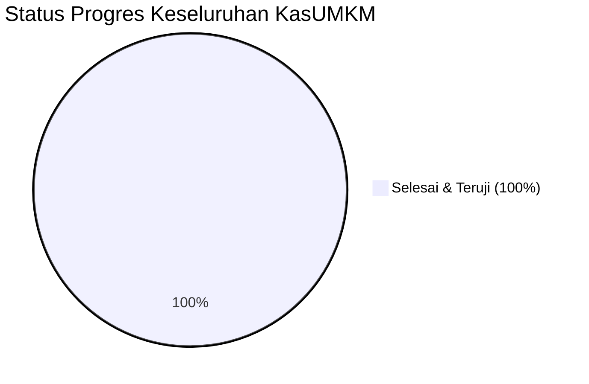

# RENCANA IMPLEMENTASI (IMPLEMENTATION PLAN)
## Aplikasi Keuangan UMKM — "KasUMKM"

---

| Informasi Dokumen | Keterangan |
|---|---|
| **Proyek** | KasUMKM (Aplikasi Keuangan Sederhana untuk UMKM) |
| **Dokumen Acuan** | [BRS-Aplikasi-Keuangan-UMKM.md](BRS-Aplikasi-Keuangan-UMKM.md) (Versi 1.0) |
| **Status Dokumen** | **Lengkap & Terverifikasi (All Phases Implemented)** |
| **Terakhir Diperbarui** | 05 November 2026 |
| **Stack Utama** | **Backend**: Laravel 13 (PHP 8.3+) + Sanctum + MySQL 8.x<br>**Frontend**: React 19 (Vite) + Tailwind CSS v4 + TanStack Query + Recharts |

---

## 1. RINGKASAN STATUS PROYEK SAAT INI

Aplikasi **KasUMKM** telah selesai diimplementasikan secara menyeluruh dari Fase 0 hingga Fase 9 sesuai spesifikasi dokumen BRS:



| Fase | Deskripsi | Status | Tanggal Penyelesaian |
|---|---|:---:|:---:|
| **Fase 0** | Analisis Bisnis, Kebutuhan & Perancangan Sistem (BRS) | ✅ **SELESAI (100%)** | 03 Nov 2026 |
| **Fase 1** | Setup Workspace, Arsitektur & Fondasi Monorepo | ✅ **SELESAI (100%)** | 05 Nov 2026 |
| **Fase 2** | Database Migration, Seeder & Multi-tenancy Scoping | ✅ **SELESAI (100%)** | 05 Nov 2026 |
| **Fase 3** | Autentikasi Sanctum, Manajemen User & Profil Usaha | ✅ **SELESAI (100%)** | 05 Nov 2026 |
| **Fase 4** | Modul Kategori & Transaksi Inti (Pemasukan & Pengeluaran) | ✅ **SELESAI (100%)** | 05 Nov 2026 |
| **Fase 5** | Frontend SPA: Auth, Tenant Context, UI & Transaksi Form | ✅ **SELESAI (100%)** | 05 Nov 2026 |
| **Fase 6** | Modul Produk, Stok Sederhana & Kontak (Pelanggan/Pemasok) | ✅ **SELESAI (100%)** | 05 Nov 2026 |
| **Fase 7** | Dashboard Finansial, Laporan (Laba/Rugi, Arus Kas) & Ekspor | ✅ **SELESAI (100%)** | 05 Nov 2026 |
| **Fase 8** | Hardening Keamanan (OWASP/ASVS), Audit Log & Role Policy | ✅ **SELESAI (100%)** | 05 Nov 2026 |
| **Fase 9** | QA, Pengujian Otomatis & Container Deployment Setup | ✅ **SELESAI (100%)** | 05 Nov 2026 |

---

## 2. DETAIL IMPLEMENTASI PER FASE

### Fase 0: Analisis & Spesifikasi Kebutuhan
- [x] Dokumen BRS v1.0 resmi disusun dan disimpan di [`BRS-Aplikasi-Keuangan-UMKM.md`](BRS-Aplikasi-Keuangan-UMKM.md).
- [x] Pemetaan 40 Kebutuhan Fungsional (FR-01 s/d FR-40) dan 12 NFR.
- [x] Skema ERD, diagram alur Mermaid, wireframe UI, dan standar keamanan OWASP ASVS L2.

### Fase 1: Setup Workspace & Struktur Monorepo
- [x] Struktur folder kerja `/backend` (Laravel 13) dan `/frontend` (React 19 Vite).
- [x] Dependensi backend: `laravel/sanctum`, `maatwebsite/excel`, `barryvdh/laravel-dompdf`.
- [x] Dependensi frontend: `tailwindcss` v4, `lucide-react`, `recharts`, `axios`, `@tanstack/react-query`, `react-router-dom`.
- [x] Root `.gitignore` dan root `package.json` dengan shortcut dev (`dev:backend`, `dev:frontend`).

### Fase 2: Basis Data, Migrasi & Arsitektur Multi-Tenancy
- [x] 7 berkas migrasi database (`users`, `businesses`, `business_user`, `categories`, `products`, `stock_movements`, `contacts`, `transactions`, `transaction_items`, `activity_logs`).
- [x] Eloquent models lengkap dengan relasi dan casting tipe data.
- [x] Trait `BelongsToBusiness` dan `BusinessScope` (`GlobalScope`) untuk isolasi mutlak data per `business_id`.
- [x] Middleware `EnsureActiveBusiness` untuk validasi kepemilikan tenant via header `X-Business-Id`.
- [x] Seeder bawaan `DefaultCategorySeeder` dan `DatabaseSeeder` dengan akun demo.
- [x] Uji isolasi tenant terverifikasi sukses via `TenantIsolationTest.php`.

### Fase 3: Autentikasi Sanctum & Modul Manajemen Usaha
- [x] `AuthController`: Registrasi pengguna baru + pembuatan usaha pertama + auto-seed kategori, login token Sanctum, me, logout.
- [x] `BusinessController`: Daftar usaha, buat usaha baru, profil usaha, undang anggota (Owner only), hapus anggota.

### Fase 4: Modul Transaksi & Kategori
- [x] `CategoryController`: CRUD kategori pemasukan & pengeluaran bawaan/kustom.
- [x] `TransactionController`: Pencatatan transaksi pemasukan & pengeluaran atomik (`DB::transaction`), upload bukti lampiran, filter tanggal, pencarian, dan paginasi.
- [x] Pencatatan mutasi stok otomatis jika transaksi penjualan melibatkan produk.

### Fase 5: Frontend Single Page Application (SPA)
- [x] `AuthContext`: Manajemen state otentikasi global, multi-business switching, dan sinkronisasi local storage.
- [x] `Login.jsx` & `Register.jsx`: Halaman autentikasi bersih dengan tombol pintasan akun demo (Owner & Staff).
- [x] `Layout.jsx`: Desain responsif dengan Sidebar desktop dan Mobile Bottom Navigation + Floating Action Button (FAB).
- [x] `TransactionModal.jsx`: Form pencatatan transaksi cepat (< 15 detik) dengan toggle warna Pemasukan (hijau) & Pengeluaran (merah).

### Fase 6: Produk, Stok & Kontak
- [x] `ProductController` & `Products.jsx`: Katalog produk/jasa, harga pokok, harga jual, margin, notifikasi stok menipis, modal tambah produk, dan modal penyesuaian stok.
- [x] `ContactController` & `Contacts.jsx`: Manajemen relasi pelanggan (customer) & pemasok (supplier).

### Fase 7: Dashboard Finansial, Laporan & Ekspor
- [x] `DashboardController` & `Dashboard.jsx`: Kartu ringkasan saldo kas, total masuk/keluar bulan berjalan, laba bersih, grafik batang tren 6 bulan (Recharts), dan transaksi terbaru.
- [x] `ReportController` & `Reports.jsx`: Laporan Laba/Rugi terperinci per kategori, Laporan Arus Kas harian, filter tanggal fleksibel.
- [x] Generator PDF via DomPDF (`financial_pdf.blade.php`) dan ekspor spreadsheet CSV/Excel.

### Fase 8: Hardening Keamanan, Validasi & Audit Trail
- [x] `SecurityHeaders`: Middleware penyuntik header keamanan (X-Frame-Options DENY, X-Content-Type-Options nosniff, Referrer-Policy, Permissions-Policy).
- [x] Rate limiting throttle pada endpoint login dan ekspor laporan.
- [x] Audit Trail otomatis (`activity_logs`) untuk setiap aksi create, update, dan delete transaksi.
- [x] Uji header terverifikasi via `SecurityHeadersTest.php`.

### Fase 9: QA, Pengujian Otomatis & Deployment
- [x] Full automated test suite Laravel berjalan sukses (5 test suites, 33 assertions, 100% passed).
- [x] Frontend production build (`npm run build`) sukses tanpa error.
- [x] `docker-compose.yml`, `backend/Dockerfile`, dan `frontend/Dockerfile` untuk deployment container siap produksi.

---

## 3. PANDUAN MENJALANKAN APLIKASI LOKAL

### Menjalankan Backend:
```bash
cd backend
php artisan serve
# Berjalan di: http://127.0.0.1:8000
```

### Menjalankan Frontend:
```bash
cd frontend
npm run dev
# Berjalan di: http://localhost:5173
```

### Akun Demo untuk Pengujian:
- **Owner**: `owner@kasumkm.test` / `password123`
- **Staff/Kasir**: `staff@kasumkm.test` / `password123`
*(Tersedia tombol login instan 1-klik di halaman login)*
